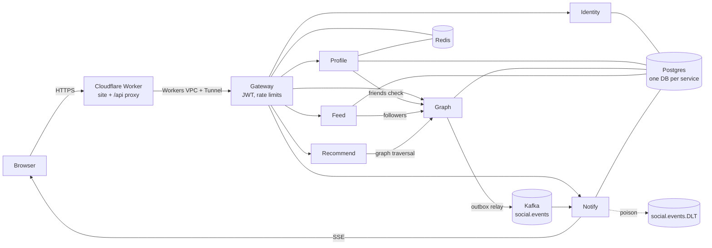

# Vertex

[](https://github.com/mofchris/vertex-social-graph-platform/actions/workflows/ci.yml)

**A social network built as seven Java services on Postgres, Redis and Kafka, running live, with a
demo that shows you what each action did inside it.**

**Live: [vertex.mofchris.workers.dev](https://vertex.mofchris.workers.dev)** · open **Live demo** and
press **Start the demo**. No sign-up: it creates a throwaway account and pairs you with one of 80
seeded people, so you can watch both ends of every event. Data resets daily at 04:00 UTC.

Prefer a fixed account? Every seeded person signs in with the password `vertex-demo`, for example
`avery.okafor@vertex.demo`.

## What you can do in the demo

1. **Follow your partner** and watch the event cross the gateway, Graph's transactional outbox,
   a Kafka partition and Notify's idempotent consumer, then arrive on their screen over SSE. Every
   lane is drawn from real timings: your round trip, the gateway's `Server-Timing`, outbox
   timestamps, the partition and offset Notify consumed it from.
2. **Have them follow you back**, and see your own notification arrive live.
3. **Post**, and see Feed write it into your follower's timeline (fan-out on write).
4. **Replay your follow event** with the same id: Kafka delivers it again, Notify's ledger counts
   the duplicate, and nobody is notified twice.
5. **Send a record Notify can't parse**: it lands on the dead-letter topic with its error, and the
   partition keeps flowing.

## Architecture



| Service | Port | Owns |
|---|---|---|
| [Gateway](./services/gateway) | 8088 | The only way in: routing, JWT at the edge, token buckets in Redis (per IP, per user, sign-in, writes), streamed SSE, `/api/status` |
| [Identity](./services/identity) | 8080 | Sign-up, sign-in, 15-minute access tokens, refresh rotation with reuse detection |
| [Profile](./services/profile) | 8081 | Profiles behind a Redis read-through cache; privacy applied at serve time |
| [Graph](./services/graph) | 8082 | Follows, friendships, blocks; transactional outbox to Kafka |
| [Feed](./services/feed) | 8083 | Posts and timelines; push on write, pull for accounts over 20 followers |
| [Notify](./services/notify) | 8084 | Idempotent Kafka consumer, dead-letter topic, coalescing, SSE |
| [Recommend](./services/recommend) | 8085 | Friends of friends with supernode caps, popular fallback for new users |

Each service owns its database and schema (Flyway). Design notes: [PROJECT.md](./PROJECT.md).
Failure modes and which ones the code handles: [EDGE_CASES.md](./EDGE_CASES.md).

## Run it locally

Needs Docker. One command builds the services, starts Postgres, Redis and Kafka, waits for every
health check and seeds the 80 demo people:

```bash
docker compose up -d --build
```

The first build takes about ten minutes; after that the stack starts in about a minute. Then:

```bash
cd web && npm install && npm run dev     # http://localhost:3000, /api proxied to the gateway on :8088
```

Tests: `cd services/<name> && ./mvnw test` (Testcontainers needs Docker), and
`cd web && npm run build && npm run lint`.

## How it's hosted for free

| Piece | Where | Cost |
|---|---|---|
| Whole backend (7 services, Postgres, Redis, Kafka) | The owner's Windows PC: Docker Compose under WSL 2, started with Windows by systemd | Free |
| Network path to it | Cloudflare Tunnel: an outbound-only connector, no open ports, no home IP exposed | Free |
| Site and `/api` proxy | Cloudflare Worker with static assets, reaching the tunnel through Workers VPC | Free plan |
| When the PC is off | The demo offers a run recorded against the real services, clearly labelled as a recording | Free |

The site is always up; the live demo is live while that PC is on. Measured on the running stack:
about 3 GB of memory in use, CPU near idle between requests. The Workers free plan allows 100,000
requests a day.

The production setup lives in [`deploy/`](./deploy): the compose overlay (nothing published,
secrets from `deploy/.env`, the tunnel connector), systemd units for start-on-boot and the nightly
reset, and a bootstrap script that sets up either a Windows PC under WSL 2 or a Linux VM (an
Oracle Cloud Always Free ARM VM fits it). [`deploy/README.md`](./deploy/README.md) covers both,
plus redeploying and re-recording the offline run.

## Repository layout

```
services/   seven Spring Boot services, each with its own README, Dockerfile and tests
web/        the site and demo (Next.js static export) and the Cloudflare Worker
deploy/     production overlay, systemd units, reset and bootstrap scripts
scripts/    Postgres init, demo seed
```
